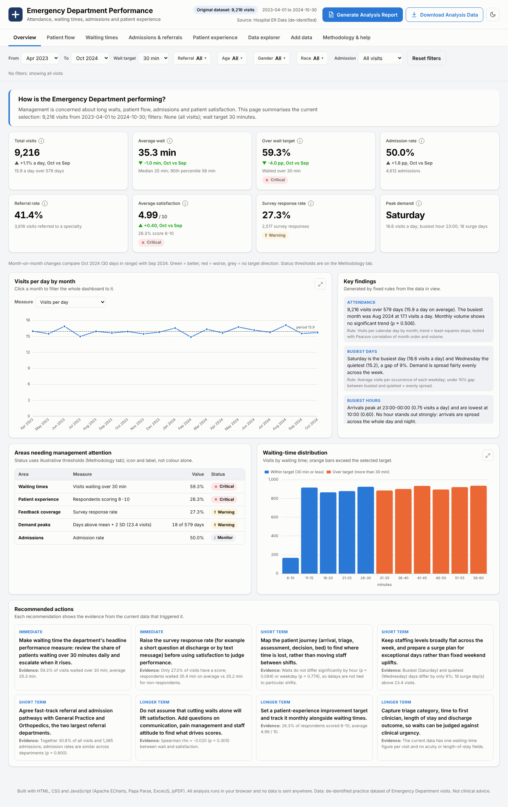
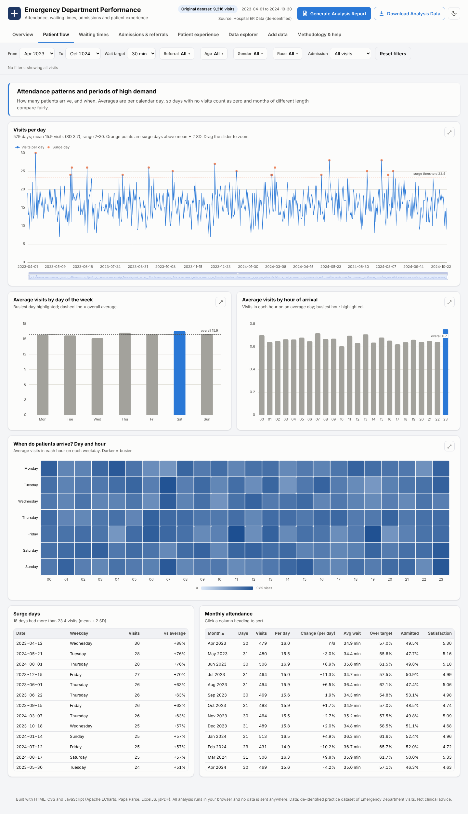
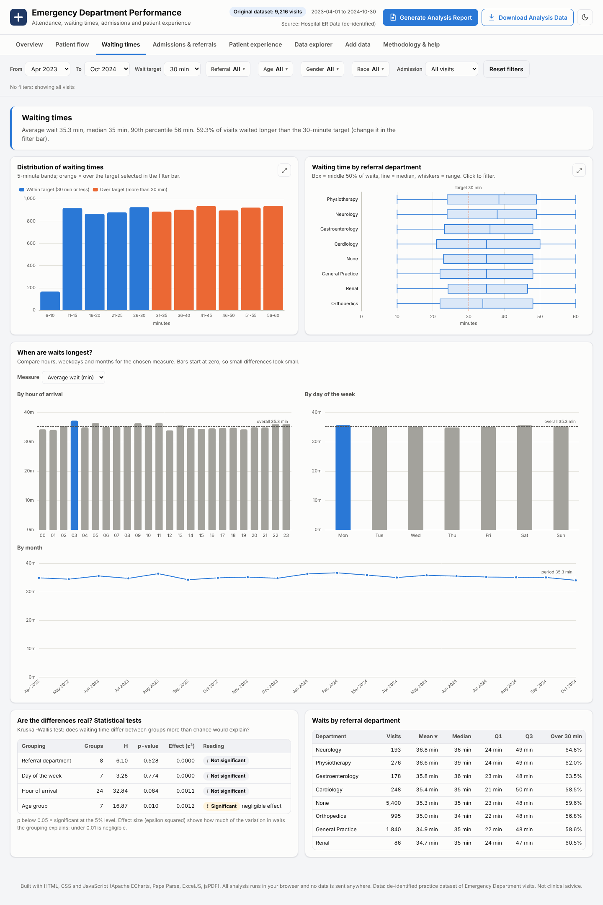
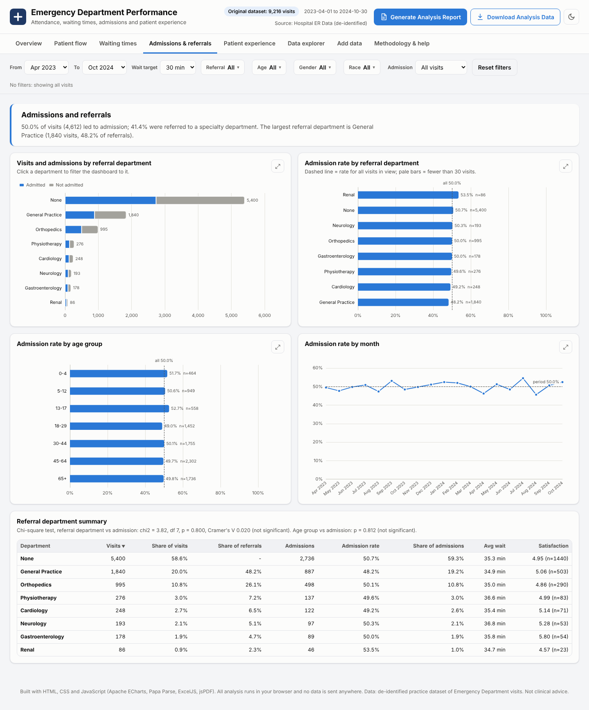
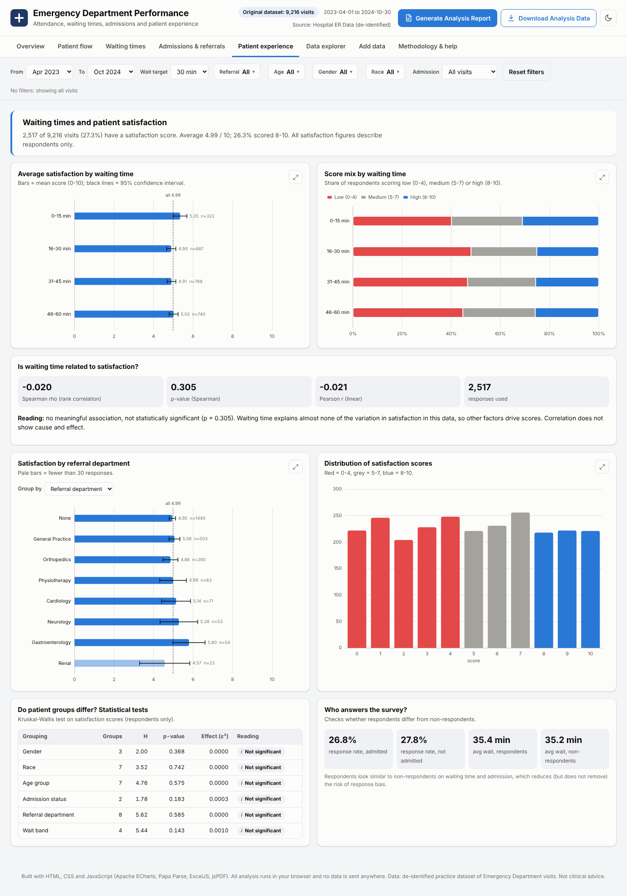
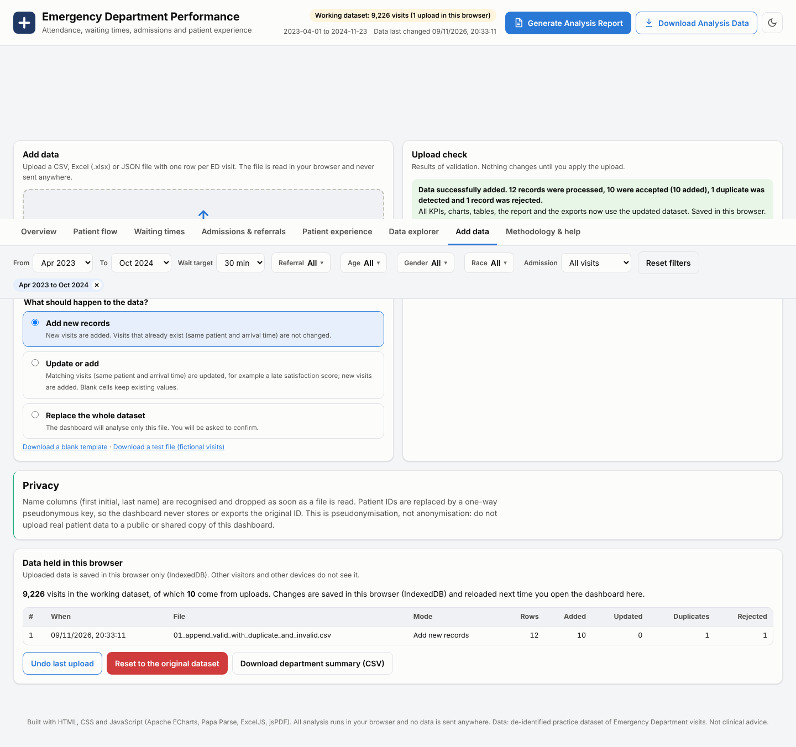
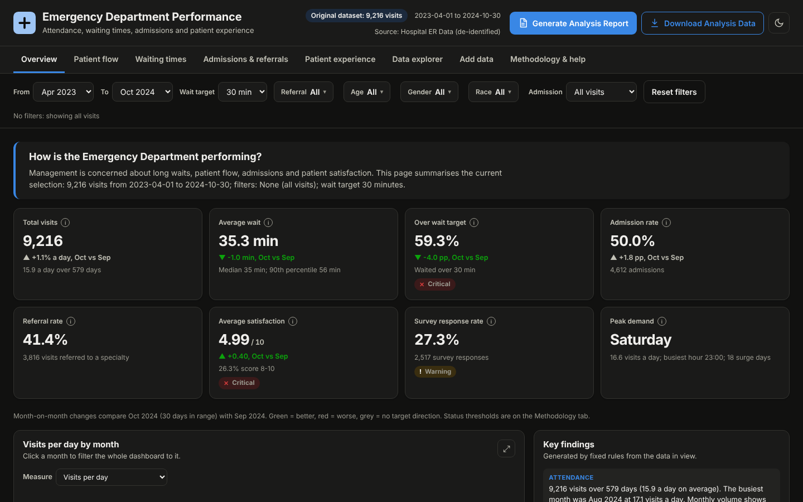
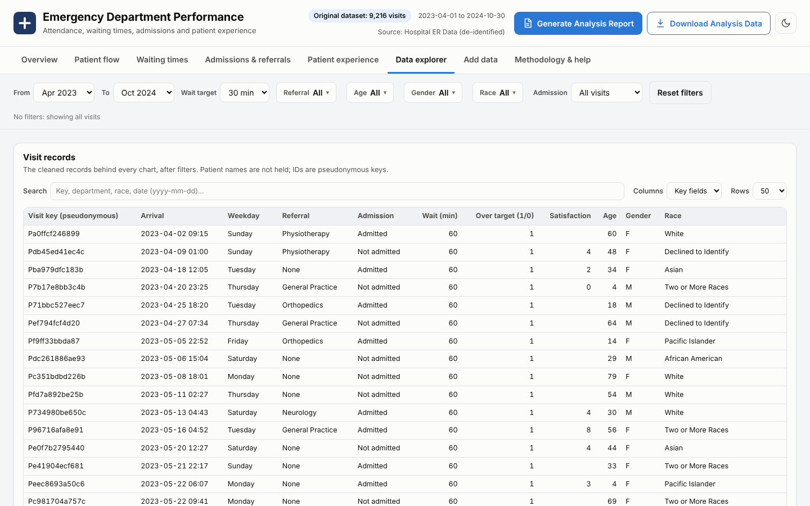
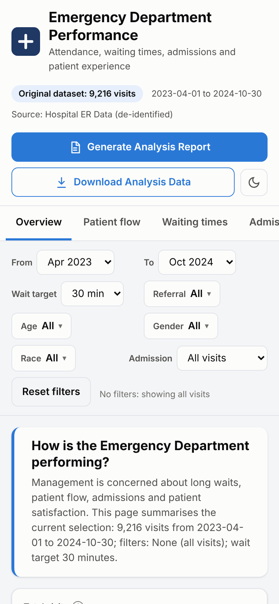

# Emergency Department Performance Dashboard: Attendance, Waiting Times, Admissions and Patient Experience

An interactive, browser-based dashboard for an Emergency Department (ED) management team. It shows:

- how many patients attend, and when;
- how long they wait, and against what target;
- who is admitted, and from which referral routes;
- whether waiting time is related to patient satisfaction;
- which areas need management attention.

Every number is calculated live from the data. Users can add new visits, and the whole analysis, including a downloadable PDF report and data export, updates immediately.

> **Synthetic-data disclaimer.** The dataset appears to be a fictional practice dataset of 9,216 ED visits, not records from a real hospital. Patient names were removed and IDs pseudonymised before publication. The findings demonstrate the analytical method and must not be read as evidence about any real Emergency Department.



## 1. Project overview

The project turns a flat file of ED visits into an operational performance tool:

- KPI cards with month-on-month change and status;
- demand profiles and surge-day detection;
- waiting-time distributions against a selectable target;
- admission and referral analysis;
- patient-experience analysis with statistical tests;
- rule-based key findings and recommendations, each with its evidence.

It runs entirely in the browser, can be hosted free on GitHub Pages, and also works when opened straight from a folder.

## 2. Business scenario

A Data Analyst supports the management of a hospital's Emergency Department. Management has expressed concerns about long waiting times, patient flow, admission patterns and patient satisfaction. They want a dashboard that gives a clear picture of operational performance and helps identify the areas that require management attention.

## 3. Business problem

Without consistent measurement, management cannot tell:

- whether waits are long everywhere or only at certain times or for certain referral routes;
- when demand really peaks;
- what drives admissions;
- whether shorter waits would lift satisfaction.

Decisions on staffing, surge planning and process improvement need that evidence. The tool must also be one the team can keep using as new months of data arrive.

## 4. Objectives

1. Evaluate patient attendance patterns.
2. Assess Emergency Department waiting times.
3. Examine admission and referral patterns.
4. Identify periods of high patient demand.
5. Examine the relationship between waiting times and patient satisfaction.
6. Develop an operational performance dashboard.

| Business question | Where it is answered |
|---|---|
| How many patients visit the ED? | Overview KPIs; Patient flow |
| Which days and hours have the highest volume? | Patient flow (weekday, hour, heatmap) |
| How does attendance vary across months? | Overview trend; monthly table |
| What are the average and median waiting times? | Overview KPIs; Waiting times |
| What % of patients exceed the waiting-time target? | KPI "Over wait target"; distribution chart |
| Which days and hours have the longest waits? | Waiting times (by hour, weekday, month + tests) |
| Are certain referral departments associated with longer waits? | Box plot by department + Kruskal-Wallis test |
| What % of patients are admitted? | KPI "Admission rate" |
| Which referral departments generate the most admissions? | Admissions & referrals |
| Is waiting time associated with satisfaction? | Patient experience (Spearman, wait bands with CIs) |
| How does satisfaction vary across patient groups? | Patient experience (by group + tests) |

## 5. Tools and technologies

| Tool | Version | Used for |
|---|---|---|
| HTML5, CSS3, JavaScript (no framework) | - | Application, design system (light and dark), data processing, statistics |
| [Apache ECharts](https://echarts.apache.org/) | 6.1.0 | Charts |
| [Papa Parse](https://www.papaparse.com/) | 5.4.1 | Reading CSV files |
| [ExcelJS](https://github.com/exceljs/exceljs) | 4.4.0 | Reading and writing Excel files |
| [jsPDF](https://github.com/parallax/jsPDF) and jsPDF-AutoTable | 4.2.1 / 5.0.9 | Generating the PDF report in the browser |
| IndexedDB (built into browsers) | - | Saving uploaded data locally |
| Python (pandas, NumPy, SciPy) | - | De-identification, reference calculations and processed files |
| Playwright | 1.63.0 | Automated end-to-end tests |

The libraries are stored in `assets/vendor/` (versions and licences in `VERSIONS.txt`). The page makes no external requests, so it works offline. A small SHA-256 function and the statistical tests (Kruskal-Wallis, chi-square, correlation, confidence intervals) are implemented in `assets/js/utils.js` and verified against SciPy.

## 6. Dataset overview

| Item | Value |
|---|---|
| Source | `Hospital_ER_Data.csv` (supplied with the brief; a widely used practice dataset whose origin and licence are not documented) |
| Rows | 9,216 visits, one row per visit |
| Period | 1 April 2023 to 30 October 2024 (19 months, 579 days) |
| Fields | Patient ID, arrival date-time, first initial, last name, gender, age, race, referral department, admission flag, satisfaction score (0-10), waiting time (minutes), "Patients CM" flag |
| Quality notes | 72.7% of satisfaction scores blank (no response); 58.6% of visits have no specialty referral (`None`); 24 visits with gender `NC`; `Patients CM` undocumented |
| Privacy | Names dropped; IDs replaced by pseudonymous keys; raw file excluded from the repository |

Full field definitions are in [`data/data-dictionary.md`](data/data-dictionary.md).

## 7. Dashboard features

- **Overview:**
  - 8 KPI cards (visits, average wait, % over target, admission rate, referral rate, satisfaction, response rate, peak demand), with month-on-month change and status badges;
  - monthly trend with a selectable measure;
  - rule-based key findings;
  - "areas needing management attention" table;
  - waiting-time distribution;
  - recommended actions with evidence.
- **Patient flow:** daily visits with surge days, weekday and hour profiles, a weekday x hour heatmap, a surge-day list and a sortable monthly table.
- **Waiting times:**
  - distribution against the target;
  - box plot by referral department;
  - average, median or % over target by hour, weekday and month;
  - Kruskal-Wallis tests with effect sizes;
  - department table.
- **Admissions & referrals:** visits and admissions by department, admission rate by department, age group and month, a chi-square test and a summary table.
- **Patient experience:**
  - satisfaction by wait band with 95% confidence intervals;
  - score mix (low/medium/high);
  - correlation panel;
  - satisfaction by patient group;
  - score distribution;
  - group tests;
  - response-bias check.
- **Data explorer:** search, sort, column sets and pagination over the records being analysed.
- **Add data:** upload, validation preview, three modes, upload history, undo and reset.
- **Methodology & help:** KPI definitions, cleaning and privacy rules, analysis and status rules, upload format.
- **Header buttons:** Generate Analysis Report (PDF), Download Analysis Data (CSV/Excel), light/dark mode.

## 8. How the dashboard works

1. **Loading.** The de-identified base data is embedded in `data/base-data.js`, so the page also works from `file://`. It is read through the same pipeline as any upload: column mapping, validation and pseudonymisation.
2. **Processing.** `derive()` adds the analysis fields: date, month, weekday, hour, age group, wait band, over-target flag, response and score group.
3. **Filtering.** The filters select the rows in view. `analyse()` then computes, from those rows:
   - period-aware KPIs;
   - summaries by month, weekday, hour and department;
   - surge days;
   - all statistical tests;
   - the attention table, insights and recommendations.
4. **Rendering.** Tabs, charts, report and exports all read that one analysis context, so they always agree. Only the visible tab is redrawn; the others refresh when opened.

## 9. Interactive functionality

- Filters for month range, referral department, age group, gender, race and admission status. Active filters appear as removable chips.
- A **wait target** selector (15/20/30/45/60 min) that changes "% over target" everywhere.
- Click a month on a trend chart, or a department on the box plot or bar charts, to filter the whole dashboard.
- Measure selectors (monthly trend, waiting-time charts) and a grouping selector (satisfaction by group).
- Tooltips with exact values and sample sizes, a full-screen view for every chart, and sortable tables.
- Keyboard navigation (arrow keys between tabs, Enter to sort), text alternatives for charts, and status shown with icon and label.

## 10. Additional data upload process

1. Open **Add data** and choose a mode:
   - **Add new records:** new visits only.
   - **Update or add:** matching visits are updated (for example a late satisfaction score) and new ones are added. Blank cells keep existing values.
   - **Replace the whole dataset:** you will be asked to confirm.
2. Drop a **CSV, Excel (.xlsx) or JSON** file (up to 10 MB / 50,000 rows).
3. The file is read **in the browser**:
   - **Columns.** Names are matched ignoring case and punctuation, and alternative names are recognised (for example "Wait Time", "Visit ID", "Sex").
   - **Privacy.** Name columns are dropped, and IDs are replaced by the same pseudonymous key used for the base data.
   - **Validation.** Required fields: ID, arrival date-time, wait (0-1440 min) and admission flag. Dates are parsed day first or ISO, and impossible dates are rejected.
   - **Duplicates.** Rows with the same key and arrival time are flagged, within the file and against existing data.
4. The **Upload check** shows:
   - rows read, valid, invalid, duplicates and new;
   - the column mapping;
   - the dropped name columns;
   - the reason for every row not used, downloadable as CSV.

   Nothing changes until you click **Apply upload**.
5. A confirmation states the actual result, for example: *"Data successfully added. 12 records were processed, 10 were accepted (10 added), 1 duplicate was detected and 1 record was rejected."*

Use the template or the fictional test file linked on the Add data tab to try it.

## 11. Automatic refresh and data persistence

- After an upload, undo or reset, every KPI, chart, table, filter option, insight, the report and the exports are recalculated.
- The working dataset and upload history are saved in **this browser's IndexedDB** and restored on the next visit.
- **Changes are local:** they are not visible to other visitors or on other devices. Nothing is sent to a server.
- **Undo last upload** restores the dataset as it was before that upload. **Reset to the original dataset** clears all local data.
- If browser storage is blocked (for example in some private windows), the dashboard still works, but changes last only until the page closes. The page says so.

## 12. Analysis performed

- **Attendance:**
  - visits per calendar day by month, weekday and hour;
  - weekday x hour heatmap;
  - trend test;
  - year-on-year comparison of matching months.
- **High demand:** surge days above mean + 2 SD of daily visits.
- **Waiting times:**
  - mean, median and 90th percentile;
  - % over a selectable target;
  - Kruskal-Wallis tests by department, weekday, hour and age group, with epsilon squared.
- **Admissions and referrals:** rates and shares by department and age group; chi-square tests with Cramer's V.
- **Waits and satisfaction:**
  - Spearman and Pearson correlation;
  - mean satisfaction by wait band with 95% CIs;
  - score mix;
  - Kruskal-Wallis tests across gender, race, age group, admission status and department;
  - response-bias check.

Details: [`documentation/methodology.md`](documentation/methodology.md).

## 13. Key findings (original dataset, wait target 30 minutes)

**Attendance**
- **Volume.** 9,216 visits in 579 days, 15.9 a day. Monthly volume shows no significant trend (p = 0.51). The busiest month was August 2024 (17.1 a day). The same months of 2024 were 1.7% busier than 2023.
- **Demand is flat across the week and the day.** Saturday is busiest (16.6 a day) and Wednesday quietest (15.2), a 9% gap. Hourly arrivals range only from 0.60 to 0.75 a day.
- **Surges are occasional.** 18 days had more than 23.4 visits (mean + 2 SD), with a peak of 30.

**Waiting times**
- **Waits are long across the board.** The average is 35.3 min (median 35, 90th percentile 56), and 59.3% of visits waited over 30 minutes.
- **No time or route stands out.** Waits do not differ significantly by referral department (p = 0.53), weekday (p = 0.77) or hour (p = 0.08). Age group is statistically significant (p = 0.010) but negligible in size (epsilon squared 0.001).

**Admissions**
- **About half of visits are admitted (50.0%).** General Practice generates the most admissions among referral departments (887, 19.2% of all), followed by Orthopedics (498).
- **Admission rates are the same across departments** (chi-square p = 0.80, Cramer's V 0.02). Larger counts reflect volume.

**Satisfaction**
- **Satisfaction is low and unrelated to waiting time.** The average is 4.99/10, and only 26.3% score 8-10. Spearman rho = -0.02 (p = 0.30); means by wait band range from 4.9 to 5.4.
- **No patient group differs significantly** by gender, race, age group, admission status or department.
- **Feedback coverage is weak.** Only 27.3% of visits have a score. Respondents resemble non-respondents on waiting time and admission.

## 14. Business recommendations

| Horizon | Recommendation | Evidence |
|---|---|---|
| Immediate | Make "% waiting over target" the headline daily measure, with escalation | 59.3% over 30 min |
| Immediate | Raise the survey response rate (discharge question, text message) before judging satisfaction | 27.3% response rate |
| Short term | Map the patient journey (arrival, triage, assessment, decision, bed) to find where time is lost, rather than moving staff between shifts | No significant wait differences by hour or weekday |
| Short term | Keep staffing broadly flat across the week, and agree a surge protocol for exceptional days | 9% weekday gap; 18 surge days |
| Short term | Agree fast-track referral and admission pathways with General Practice and Orthopedics | 30.8% of visits and 1,385 admissions |
| Longer term | Investigate the real drivers of satisfaction (communication, pain management, staff attitude) | rho = -0.02 between wait and score |
| Longer term | Set and track a patient-experience target | 26.3% score 8-10 |
| Longer term | Capture triage category, time to first clinician, length of stay and outcome | Needed to judge waits against clinical urgency |

The recommendations on the dashboard are generated by rules from the data in view, so they change with filters and uploads.

## 15. Screenshots

| | |
|---|---|
|  |  |
|  |  |
|  |  |
|  |  |

All screenshots were captured automatically from the running dashboard by the test suite. They show the real analysis of the supplied data.

## 16. How to run the dashboard locally

- **Simplest:** download or clone the repository and double-click `index.html`. Everything, including the de-identified data, is bundled.
- **With a local web server** (the same way GitHub Pages serves it):
  ```bash
  python -m http.server 8000
  # then open http://localhost:8000
  ```
- **To rebuild the data from the raw file** (not included in the repository; place it in `data/raw/`):
  ```bash
  pip install -r requirements.txt
  python scripts/prepare_data.py      # de-identify, clean, reference values
  python scripts/build_base_data.py   # embed in data/base-data.js
  ```

## 17. How to deploy with GitHub Pages

1. Push the repository to GitHub, with `index.html` in the repository root. Confirm that `data/raw/Hospital_ER_Data.csv` is **not** committed; `.gitignore` excludes it.
2. Go to **Settings → Pages**. Under **Build and deployment**, choose **Deploy from a branch**, then select `main` and `/ (root)`. Save.
3. After a minute the dashboard is live at `https://<your-username>.github.io/<repository-name>/`.

No build step is needed. All paths are relative and no server code is used. The `.nojekyll` file stops GitHub from processing the files. Visitors' uploads stay in their own browsers.

## 18. Using the report download button

1. Click **Generate Analysis Report**.
2. Choose **Current filtered view** or **Entire available dataset**.
3. Click **Generate PDF**.

The report is built at that moment from the data in the dashboard, including uploads and the selected wait target. It runs to about 8-9 pages and contains:

- scope, filters and a summary;
- business context and objectives;
- dataset;
- data preparation and privacy;
- methods;
- KPI definitions;
- results by objective, with 8 charts and test tables;
- key findings;
- areas requiring attention;
- interpretation;
- recommendations;
- limitations.

An example generated from the original data is in [`documentation/sample-generated-report.pdf`](documentation/sample-generated-report.pdf).

## 19. Downloading the analysis data

Click **Download Analysis Data**, then choose **Full analysis dataset** or **Currently filtered dataset**, and **CSV** or **Excel**.

- **Contents:** the cleaned, de-identified visits actually being analysed, including uploads, with every derived field and a `record_source` column. There are no names and no original IDs.
- **Excel extras:** sheets by month, weekday, hour and referral department, and an About sheet recording the scope, filters, wait target and dataset status.
- **Safety:** text cells are protected against spreadsheet formula injection.

## 20. Repository structure

```text
├── index.html                    dashboard entry point
├── assets/
│   ├── css/styles.css            design tokens (light/dark), layout, components
│   ├── js/                       config, utils (formatting, statistics, SHA-256), data-processing, analytics,
│   │                             store (IndexedDB), charts, data-export, report-generator, app
│   ├── vendor/                   pinned third-party libraries (VERSIONS.txt)
│   └── images/                   screenshots used in this README
├── data/
│   ├── raw/                      (raw file kept locally only - excluded by .gitignore)
│   ├── er_visits_deidentified.csv  de-identified base data (also the upload format)
│   ├── base-data.js              the same data embedded for file:// use
│   ├── processed/                analysis file, summaries, cleaning log, reference values
│   └── data-dictionary.md
├── scripts/
│   ├── prepare_data.py           de-identification, cleaning and reference pipeline (pandas, SciPy)
│   └── build_base_data.py        writes data/base-data.js
├── tests/
│   ├── make_test_files.py        fictional upload fixtures (tests/data/)
│   ├── run_tests.js              138 Playwright checks
│   ├── make_test_report.py       writes test-report.md from results.json
│   ├── results.json, test-report.md, sample_generated_report.pdf
├── documentation/
│   ├── technical-analysis-report.docx / .pdf
│   ├── sample-generated-report.pdf
│   ├── methodology.md, limitations.md, user-guide.md, portfolio-positioning.md
├── requirements.txt, package.json, .gitignore, .nojekyll
```

## 21. Limitations

- The data appears synthetic, so most "no difference" results reflect how it was generated.
- There is one waiting-time value per visit, with no stated start and end point. There is no triage, length of stay, outcome or staffing data.
- Satisfaction is available for 27% of visits only.
- The 30-minute target and the status thresholds are illustrative assumptions, and can be changed.
- Pseudonymisation with an unsalted hash is not anonymisation.
- Uploaded data is stored only in the current browser.
- Tests were run in Chromium only. Publishing to GitHub Pages was not performed from the build environment.

Full list: [`documentation/limitations.md`](documentation/limitations.md). Test evidence: [`tests/test-report.md`](tests/test-report.md).

## 22. Data source and disclaimer

The dataset `Hospital_ER_Data.csv` was supplied with the project brief. It is a widely circulated practice dataset; its original author and licence are not stated in the file, so check its terms before reuse. Its distributions indicate that it is synthetic. Names and SSN-style IDs in the source were removed or pseudonymised before anything was published, and the raw file is not part of this repository.

This dashboard is a portfolio demonstration. It is not a clinical tool, it gives no clinical advice, and its findings do not describe any real hospital. Do not upload real patient data to a public copy.

## 23. Conclusion

The dashboard answers every question in the brief and, just as importantly, shows where the evidence is weak. In this data:

- long waits are widespread rather than tied to particular shifts or referral routes;
- demand is even, with occasional surges;
- admissions follow referral volume;
- satisfaction is low but unrelated to waiting time.

These findings point management towards process capacity, surge planning, better feedback and richer data capture, and away from simple rostering changes. Because every figure is recalculated from the data, the same tool can be reused as new months arrive. Its accuracy is backed by an independent pandas/SciPy check and 138 automated tests.
